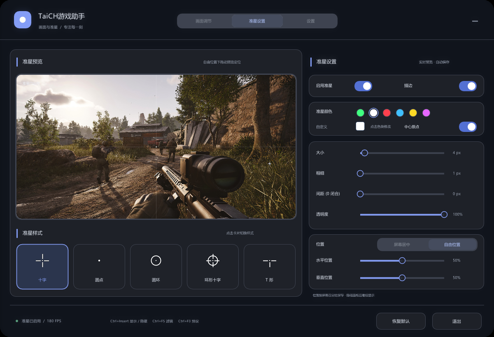
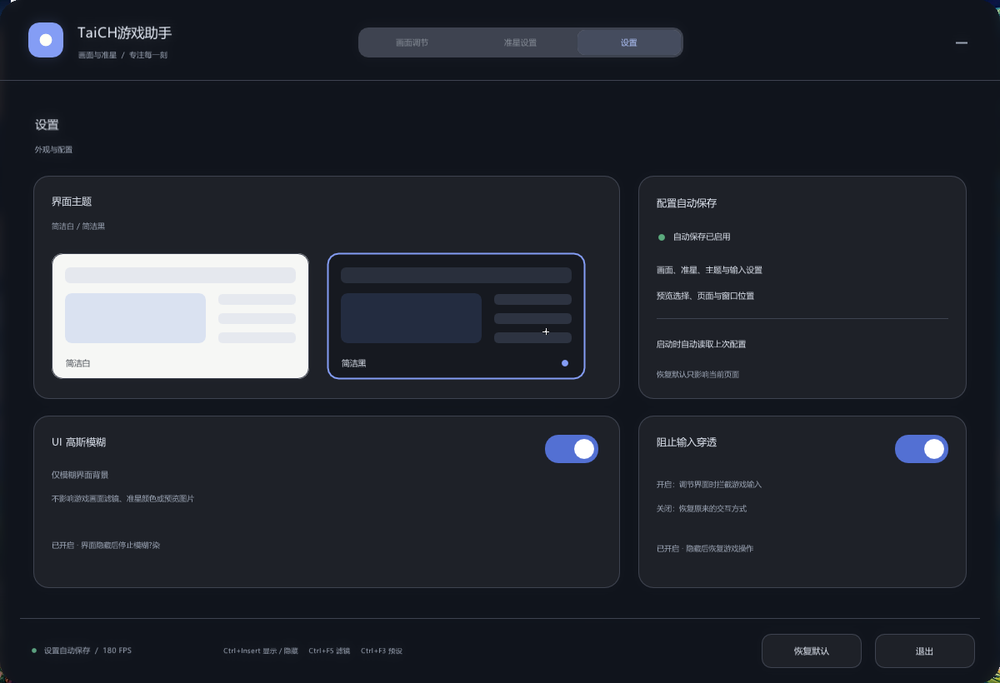

# TaiCH 游戏助手

> 一款纯 GPU 后处理的全屏画面滤镜 + 准星叠加工具（Windows x64）
>
> A GPU-based full-screen color filter and crosshair overlay for Windows, built with ImGui + Direct3D 11 + DXGI Desktop Duplication.

它把当前显示器的画面实时抓下来，用像素着色器调色（亮度、对比度、饱和度、色温、色调、伽马、清晰度），再以顶层透明窗口贴回屏幕，同时可以叠加一枚自定义准星。

**它不注入进程、不读写游戏内存、不 hook 任何 API、不需要驱动。** 整个工具只做一件事：GPU 上给画面过一遍颜色，然后把结果覆盖在桌面上。

---

## 功能

**画面调节**

- 7 项实时参数：亮度、对比度、饱和度、色温、色调、伽马、清晰度
- 5 种预设一键切换：明基、鲜艳、电影、夜战、柔和
- 室内 / 室外两张样张实时预览，可拖动对比分割线看「原图 vs 滤镜后」
- 一键重置、一键暂停（暂停后画面立即还原）

**准星**

- 5 种样式：十字、圆点、圆环、环形十字、T 形
- 独立开关，与滤镜互不影响（关掉滤镜准星仍然显示）
- 大小、粗细、间距、透明度可调，支持描边和中心点
- 6 种常用颜色 + 自定义颜色
- 位置支持「屏幕居中」或「自由位置」，坐标按屏幕百分比保存

**界面**

- 亮色 / 暗色双主题，毛玻璃背景（模糊取自当前画面，不是假透明）
- 三种交互模式：鼠标穿透 / 拦截输入 / 面板可拖动
- 所有参数自动保存到可执行文件同目录的 `filter.cfg`，退出下次自动恢复

---

## 工作原理

```
桌面画面 ──▶ DXGI 桌面复制 ──▶ 抓帧纹理
                                   │ CopyResource
                                   ▼
  顶层窗口 ◀── 交换链 ◀── HLSL 像素着色器（调色 + 3×3 锐化）
                                 ▲
                                 │ 与滤镜共用同一帧
                         ImGui 面板 + 准星叠加
```

| 环节 | 实现 |
|---|---|
| 抓帧 | `IDXGIOutputDuplication::AcquireNextFrame`，阻塞等新帧（最多 16ms），桌面静止时不空转 |
| 调色 | 内嵌 HLSL 像素着色器，全屏三角形无顶点缓冲，一次 `Draw(3)` |
| 输出 | `DXGI_SWAP_EFFECT_FLIP_DISCARD` 双缓冲交换链，`Present(0)` 不等垂直同步 |
| 叠加 | 无边框置顶分层窗口（`WS_EX_LAYERED`），`WS_EX_TRANSPARENT` 把鼠标透传给下层 |

几个关键细节：

- **防自我捕获**：用 `SetWindowDisplayAffinity(WDA_EXCLUDEFROMCAPTURE)` 把自己从桌面复制里排除，否则画面会无限嵌套重影。启动参数加 `--no-exclude` 可关闭（排查用，会有重影）。
- **延迟**：`SetMaximumFrameLatency(1)` 只允许排队 1 帧，避免多帧积压拖成残影；不等垂直同步，靠 DWM 合成取最新帧。
- **零开销空闲**：面板隐藏且滤镜、准星全关时直接隐藏窗口并 `Sleep(20)`，不占用 GPU。
- **配置写入**：先写 `filter.cfg.tmp` 再 `MoveFileEx` 原子替换，断电不会写出半个文件。

### 着色器参数映射

| 参数 | 范围 | 着色器内的换算 |
|---|---|---|
| 亮度 | -100 ~ 100 | `c += p/100 * 0.4` |
| 对比度 | -100 ~ 100 | `c = (c-0.5) * (1+p/100) + 0.5` |
| 饱和度 | -100 ~ 100 | 与亮度 `(0.2126, 0.7152, 0.0722)` 做 lerp，系数 `1+p/100` |
| 色温 | -100 冷 ~ 100 暖 | `r += p/100*0.16`，`b -= p/100*0.16` |
| 色调 | -100 品红 ~ 100 绿 | `g += p/100*0.12`，`r/b -= p/100*0.05` |
| 伽马 | -100 ~ 100 | `c = pow(c, 1/(1+p/100))` |
| 清晰度 | 0 ~ 100 | 3×3 反锐化掩模，强度 `p/100 * 2.5` |

---

## 快捷键

| 快捷键 | 功能 |
|---|---|
| `Ctrl + Insert` | 显示 / 隐藏面板 |
| `Ctrl + F5` | 开关画面滤镜 |
| `Ctrl + F3` | 循环切换滤镜预设 |
| `Ctrl + F4` | 重置画面参数 |
| `Ctrl + Alt + Q` | 退出程序 |

---

## 界面预览

以下为程序实际运行截图（暗色主题，1920×1080）。

**画面调节**


**准星设置**



**设置**



> `assets/preview_*.png` 是面板内「原图 vs 滤镜后」对比用的示例图片，可自行替换为任意同比例照片（保持文件名不变即可）。
> 仓库自带的这两张示例图取自第三方游戏实机截图，**仅作功能演示，不包含在本项目的 GPL-3.0 授权范围内**。

---

## 构建

### 依赖

- Windows 10 2004 或更高版本（x64）
- MinGW-w64 工具链，需要 `g++`、`windres` 及 Windows 系统导入库
- 无需手动准备 ImGui —— 已完整放在 `third_party/imgui-1.91.5/`

### 编译

```bat
cd /d 项目目录
set "MINGW=C:\你的工具链目录\mingw64"
build.bat
```

不设 `MINGW` 时默认使用 `D:\toolchains\mingw64`。

产物为 `build\TaiCH.exe` 与 `build\assets\`，整个 `build` 文件夹拷走即可运行。程序静态链接 C++ 运行库，**不需要另外分发 MinGW 的 DLL**。

### 源码结构

```
src/
  main.cpp              入口、窗口 / D3D 设备初始化、抓帧、内嵌 HLSL、配置读写、主循环
  TaiCH.rc              版本资源
  filter_ui.inl         画面调节页：1200x820 设计画布、预览对比、预设与参数区
  crosshair.inl         准星几何绘制（供桌面叠加与编辑器预览共用）
  crosshair_ui.inl      准星设置页
  settings_state.inl    配置序列化
  settings_ui.inl       设置页
  ui_theme.inl          亮 / 暗主题色映射
  ui_blur.inl           毛玻璃背景
  panel_input.inl       点击穿透 / 拦截输入两种交互模式
  segmented_ui.inl      分段控件动画
```

所有 `.inl` 都通过 `#include` 汇入 `main.cpp`，编译为**单个翻译单元**。这是刻意为之：布局函数大量使用 lambda 与局部状态，拆成独立编译单元反而要额外暴露一堆符号。

---

## 配置文件

参数保存在可执行文件同目录的 `filter.cfg`，纯文本，格式为 `键=值`。

```ini
enabled=1                # 滤镜总开关
brightness=0.000         # 亮度
contrast=0.000           # 对比度
saturation=0.000         # 饱和度
temperature=0.000        # 色温
tint=0.000               # 色调
gamma=0.000              # 伽马
sharpen=0.000            # 清晰度
cross_enabled=0          # 准星开关
cross_centered=1         # 1=屏幕居中，0=自由位置
cross_style=0            # 0 十字 1 圆点 2 圆环 3 环形十字 4 T 形
cross_size=12.000        # 准星大小
cross_thickness=2.000    # 线条粗细
cross_gap=4.000          # 中心间隙
cross_x=0.500000         # 横坐标（屏幕百分比）
cross_y=0.500000         # 纵坐标（屏幕百分比）
cross_r=0.2500           # 颜色 RGBA，0~1
ui_theme=0               # 0 亮色 1 暗色
ui_blur=0                # 毛玻璃背景
ui_block_input=1         # 拦截输入
ui_panel_x=305.0         # 面板位置
ui_panel_y=142.0
```

删掉这个文件即为恢复默认。仓库本身不含任何个人配置。

---

## 已知限制

- **只作用于主显示器。** 程序锁定 `MonitorFromPoint({0,0})` 所在的输出，副屏不生效。
- **独占全屏抓不到。** 请把游戏设为「无边框窗口」或「窗口化全屏」，否则桌面复制拿不到画面。桌面复制中断后程序每秒自动重试一次。
- **`WDA_EXCLUDEFROMCAPTURE` 需要 Windows 10 2004+。** 更早的系统上窗口会捕获到自己，产生重影（可用 `--no-exclude` 验证）。
- **分辨率切换会重建复制对象，但交换链不重建**，UAC 提权弹窗、独占全屏切换后可能黑一帧。
- **会轻微增加显示延迟。** 抓帧 + 调色 + 叠加走了一整套桌面合成往返，竞技场景请自行权衡。
- 界面目前为中文。

---

## 第三方组件

- [Dear ImGui](https://github.com/ocornut/imgui) 1.91.5 — MIT License，完整源码见 `third_party/imgui-1.91.5/`，许可证见其目录下 `LICENSE.txt`

字体读取自系统 `C:\Windows\Fonts`（微软雅黑 / 黑体 / 宋体），不随程序分发。界面只烘焙实际用到的汉字，避免完整字库导致贴图过大。

---

## 许可

本项目以 **GNU General Public License v3.0** 发布，全文见 [LICENSE](LICENSE)。

简言之：你可以自由使用、修改、分发，但**分发修改后的版本时必须以同样的 GPL-3.0 协议开源**，并保留版权声明。

例外：`assets/` 内的两张预览图为第三方游戏截图，不适用本协议（见上文效果预览一节）；`third_party/` 内各自遵循其原始许可证。

---

## 免责声明

- 本工具为**纯显卡端的画面后处理**，不读取、不修改任何游戏内存，不注入进程，不修改游戏文件，不提供任何自动化操作。
- 请在**合法且允许的范围内**使用。部分在线竞技游戏的用户协议可能限制第三方画面叠加或准星辅助，**是否合规由使用者自行判断并承担全部后果**，作者不承担任何责任。
- 因使用本工具导致的账号封禁、画面异常、显示器损伤或其他任何损失，作者不承担责任。
- 本项目与任何游戏开发商、发行商无关联。
