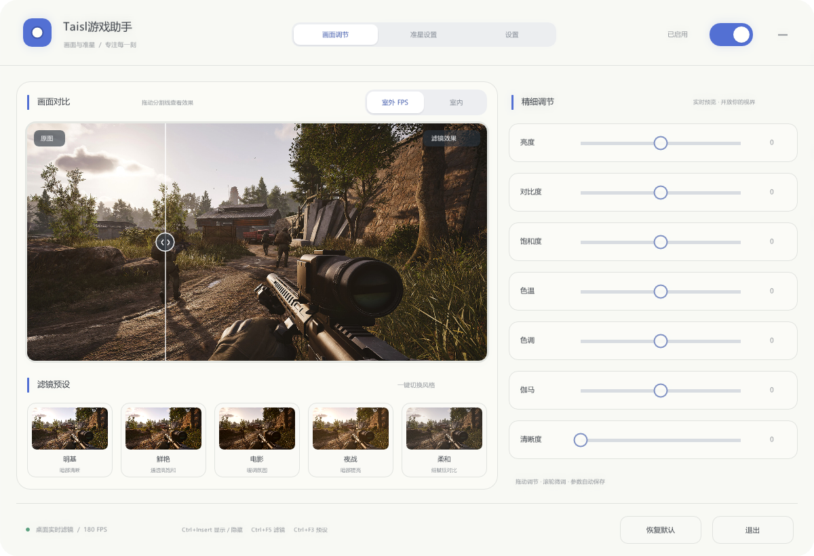
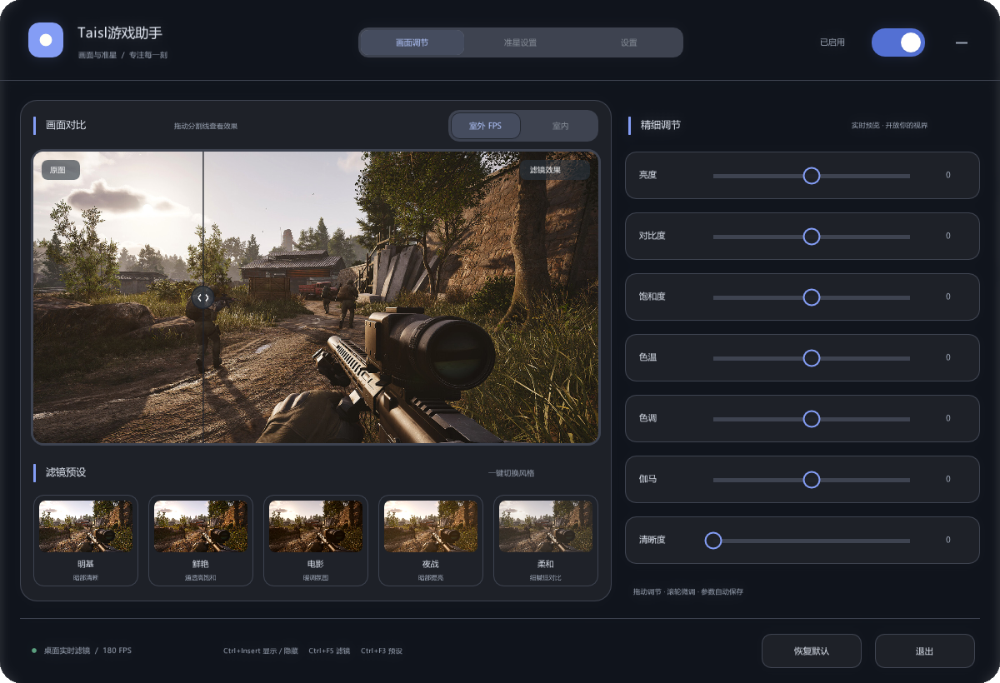
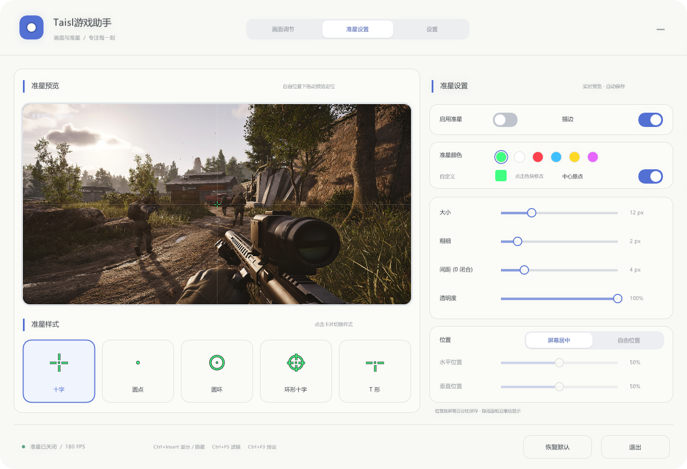
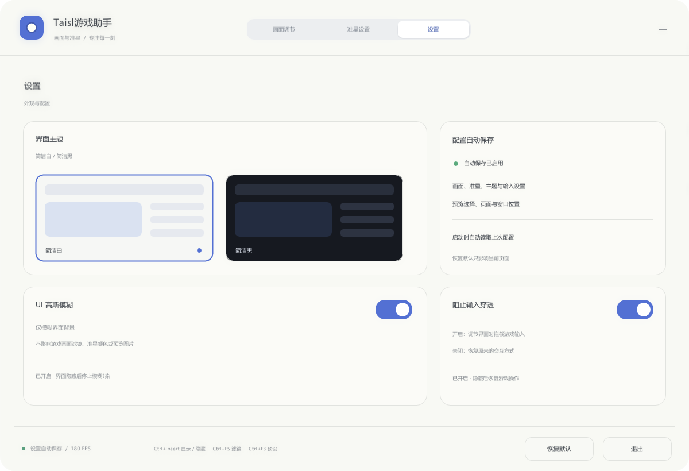
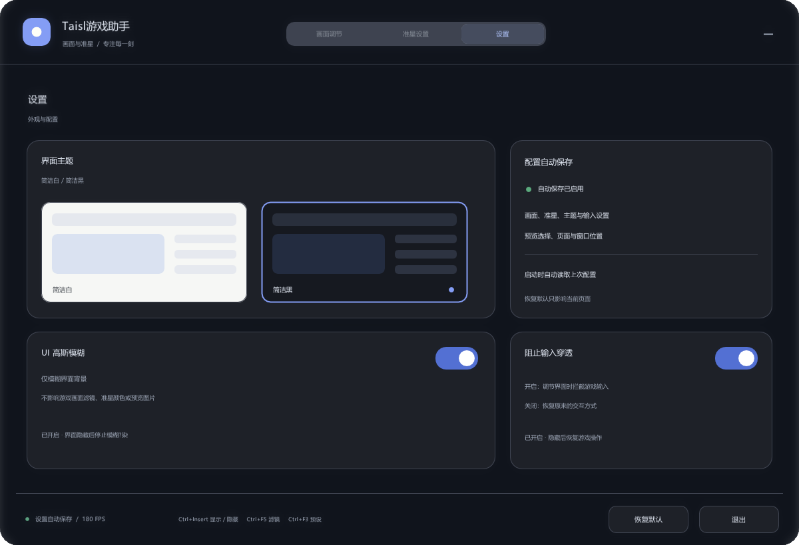

# Taisl 游戏助手

Windows 上的全屏画面滤镜，顺带带了个准星。

原理不复杂：用 DXGI 把当前显示器的画面复制出来，交给显卡上的一个像素着色器调色，再把结果画进一个置顶的透明窗口，盖回屏幕上。所以画面还是原来那个画面，只是颜色变了。

全程不注入进程、不读写游戏内存、不 hook 任何 API、不装驱动。就是一层贴在屏幕上的画，玩什么游戏都一样，桌面、视频、浏览器也照样生效。

---

*A full-screen color filter and crosshair overlay for Windows. It copies the desktop through DXGI Desktop Duplication, runs a pixel shader over it, and draws the result back onto a click-through overlay window. No process injection, no memory reading, no driver.*

---

## 界面

亮色是默认主题，暗色在「设置」里切。下面都是实际运行截图。

**画面调节**

| 亮色 | 暗色 |
|:---:|:---:|
|  |  |

**准星设置**

| 亮色 | 暗色 |
|:---:|:---:|
|  |  |

**设置**

| 亮色 | 暗色 |
|:---:|:---:|
|  |  |

---

## 能调什么

七项参数，都在着色器里实时算，不占 CPU：

| 参数 | 范围 | 干什么 |
|---|---|---|
| 亮度 | -100 ~ 100 | 整体加减亮度，会先过一遍锐化 |
| 对比度 | -100 ~ 100 | 以中灰为轴拉开或压缩明暗 |
| 饱和度 | -100 ~ 100 | 跟亮度做插值，往灰或往艳走 |
| 色温 | -100 冷 ~ 100 暖 | 红蓝反相偏移，往蓝或往黄 |
| 色调 | -100 品红 ~ 100 绿 | 绿通道为主，红蓝跟着补一点 |
| 伽马 | -100 ~ 100 | 提亮暗部或压暗高光，中间调变化最大 |
| 清晰度 | 0 ~ 100 | 3×3 反锐化掩模，加边缘对比 |

另外有五个预设，`Ctrl+F3` 循环切：明基（暗部提亮、偏锐）、鲜艳（拉饱和度）、电影（暖调低饱和）、夜战（提亮降蓝光）、柔和（低对比低饱和）。

准星是独立的，关掉滤镜它还在。五种样式（十字、圆点、圆环、环形十字、T 形），能调大小、粗细、间距、透明度、描边和中心点，六种常用色加拾色器，位置可以锁屏幕居中，也可以拖到任意位置，坐标按屏幕百分比存。

## 快捷键

| 键 | 作用 |
|---|---|
| `Ctrl + Insert` | 显示 / 隐藏面板 |
| `Ctrl + F5` | 开关滤镜 |
| `Ctrl + F3` | 切下一个预设 |
| `Ctrl + F4` | 参数全部归零 |
| `Ctrl + Alt + Q` | 退出 |

## 自己编译

只需要 MinGW-w64，不用先装 ImGui——已经整份放在 `third_party/imgui-1.91.5/` 里了。

```bat
set "MINGW=C:\你的工具链目录\mingw64"
build.bat
```

不设 `MINGW` 就默认找 `D:\toolchains\mingw64`。出来的东西在 `build\` 下，`Taisl.exe` 加一个 `assets` 文件夹，整个文件夹拷走就能跑。C++ 运行库是静态链接的，不用另外带 DLL。

源码结构：

| 文件 | 内容 |
|---|---|
| `src/main.cpp` | 窗口和设备初始化、抓帧、内嵌的 HLSL、配置读写、主循环 |
| `src/filter_ui.inl` | 画面调节页 |
| `src/crosshair.inl` | 准星的几何绘制，桌面叠加和编辑器预览共用同一份代码 |
| `src/crosshair_ui.inl` | 准星设置页 |
| `src/settings_state.inl` | 配置序列化 |
| `src/settings_ui.inl` | 设置页 |
| `src/ui_theme.inl` | 亮暗主题的配色映射 |
| `src/ui_blur.inl` | 面板的毛玻璃背景 |
| `src/panel_input.inl` | 鼠标穿透 / 拦截输入 |
| `src/segmented_ui.inl` | 顶部标签的滑动动画 |

`.inl` 全部是被 `main.cpp` `#include` 进去的，最后只编译一个翻译单元。之所以这么拆，是因为布局代码用了大量 lambda 和局部状态，真拆成独立编译单元得往外暴露一堆符号，反而更乱。

## 配置文件

参数存在 exe 同目录的 `filter.cfg`，纯文本 `键=值`，删掉就是恢复默认。改完界面松手就自动写盘，写入是先写 `.tmp` 再原子替换，断电不会留下半个文件。

```ini
enabled=1              # 滤镜总开关
brightness=0.000       # 七项调色参数，含义见上表
contrast=0.000
saturation=0.000
temperature=0.000
tint=0.000
gamma=0.000
sharpen=0.000
cross_enabled=0        # 准星开关
cross_centered=1       # 1 屏幕居中，0 自由位置
cross_style=0          # 0 十字 1 圆点 2 圆环 3 环形十字 4 T 形
cross_size=12.000
cross_thickness=2.000
cross_gap=4.000
cross_x=0.500000       # 坐标是屏幕百分比
cross_y=0.500000
cross_r=0.2500         # 颜色 RGBA，0~1
cross_g=1.0000
cross_b=0.5000
cross_a=1.0000
ui_theme=0             # 0 亮色 1 暗色
ui_blur=0              # 毛玻璃背景
ui_block_input=1       # 拦截输入
ui_panel_x=305.0
ui_panel_y=142.0
```

## 已知问题

这几个坑是真的存在，用之前先看一眼：

**只认主显示器。** 程序锁的是 `MonitorFromPoint({0,0})` 那个输出，副屏不生效。多屏的话把游戏拖到主屏。

**独占全屏抓不到。** 桌面复制拿不到独占全屏的画面，游戏得设成无边框窗口或窗口化全屏。复制断了程序每秒重试一次，切回来通常能自己恢复。

**`WDA_EXCLUDEFROMCAPTURE` 要 Windows 10 2004 以上。** 这是用来防止自己拍自己的，否则画面会无限嵌套重影。老系统上窗口会拍到自己，加 `--no-exclude` 启动能看出来是这个问题。

**切分辨率或弹 UAC 的时候可能黑一帧。** 复制对象会重建，但交换链没重建，所以有一瞬间是空的。

**会多一点延迟。** 抓帧、调色、重新合成走了一整套桌面往返，具体多少看显卡和刷新率，竞技游戏自己掂量。

**界面只有中文。** 字体是从系统的 `C:\Windows\Fonts` 里读的雅黑/黑体/宋体，只烘焙了界面上实际用到的那些汉字。

## 第三方

- [Dear ImGui](https://github.com/ocornut/imgui) 1.91.5，MIT 协议，整份源码在 `third_party/imgui-1.91.5/`，许可证见该目录下的 `LICENSE.txt`

## 许可

GPL-3.0，全文见 [LICENSE](LICENSE)。用、改、分发都行，但你要是把改过的版本发出去，得同样用 GPL-3.0 开源。

例外是 `assets/` 里那两张示例图：它们取自第三方游戏截图，只用来演示面板里的「原图 / 滤镜效果」对比，**不在这份 GPL 授权范围内**。想换掉的话保持文件名，换成任意同比例照片就行。

## 免责

- 这工具只在显卡层改画面颜色，不读游戏内存、不改游戏文件、不注入、不做任何自动操作。
- 但有些在线竞技游戏的用户协议可能会限制第三方画面叠加和准星辅助，**用不用、合不合规自己判断**，出事我不负责。
- 封号、画面异常、烧屏之类的问题，也都不负责。
- 跟任何游戏开发商、发行商没有任何关系。
